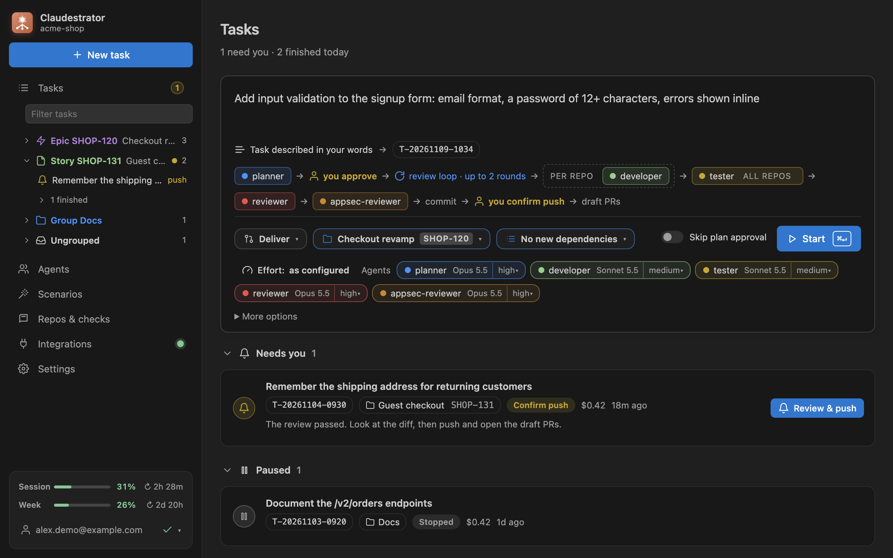
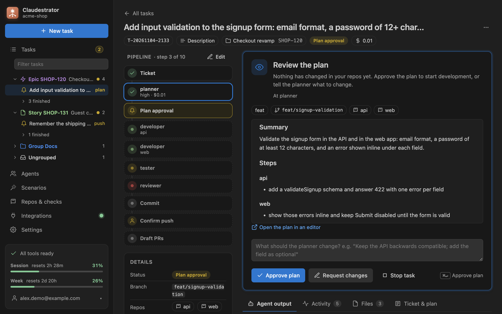
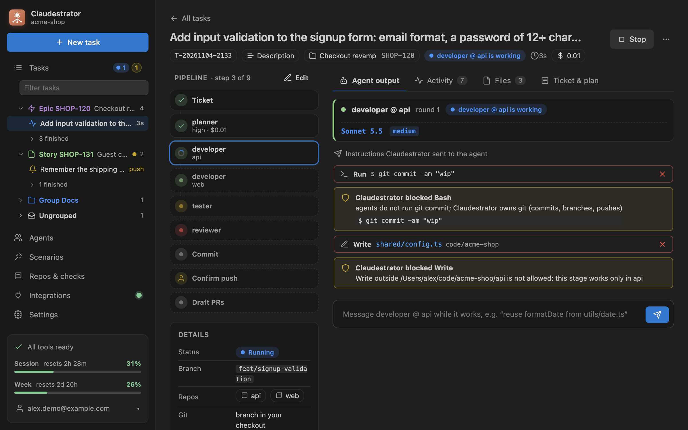
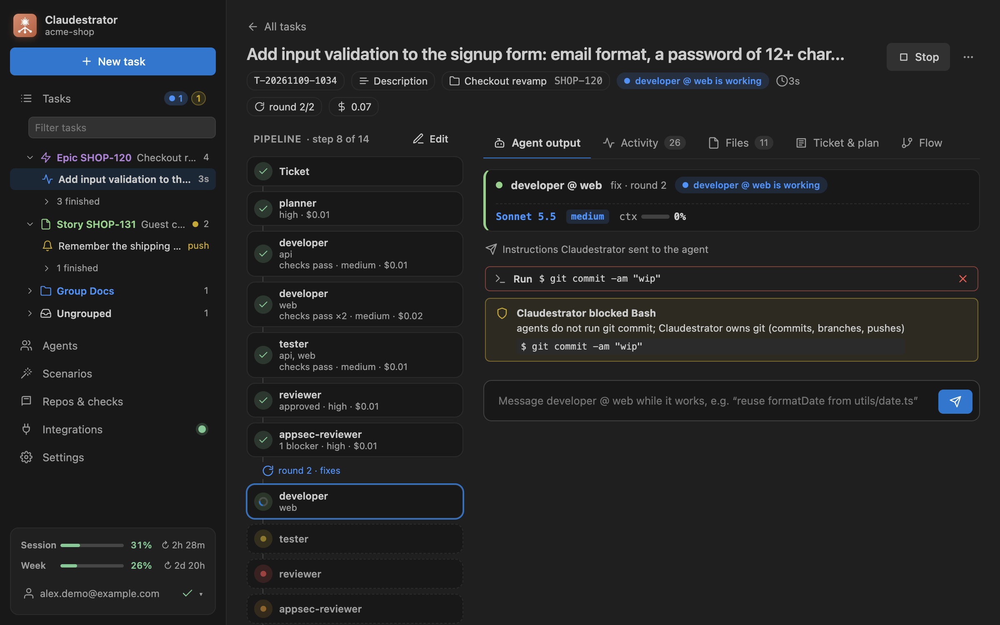
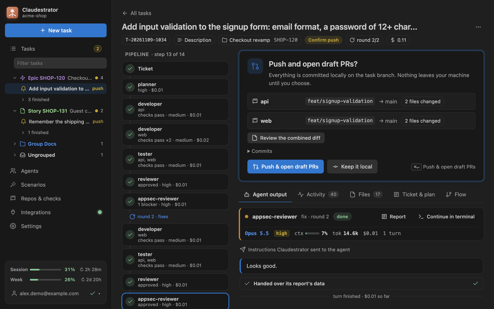
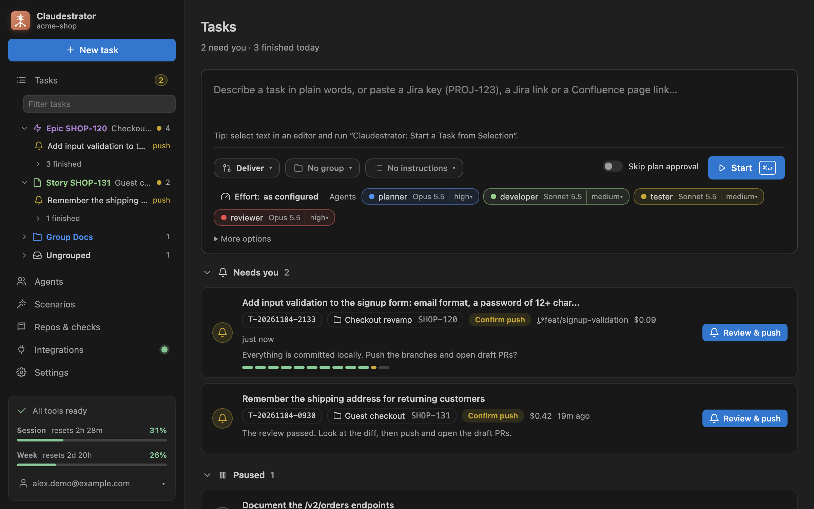
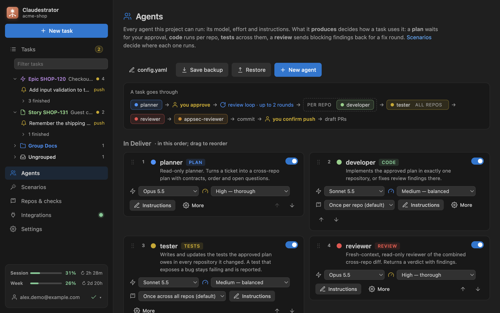
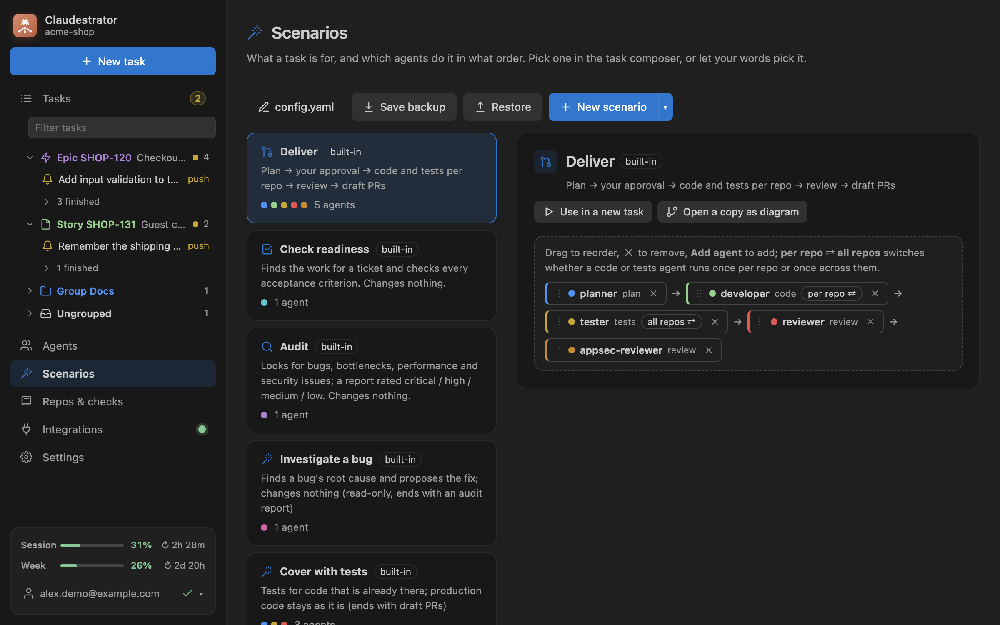
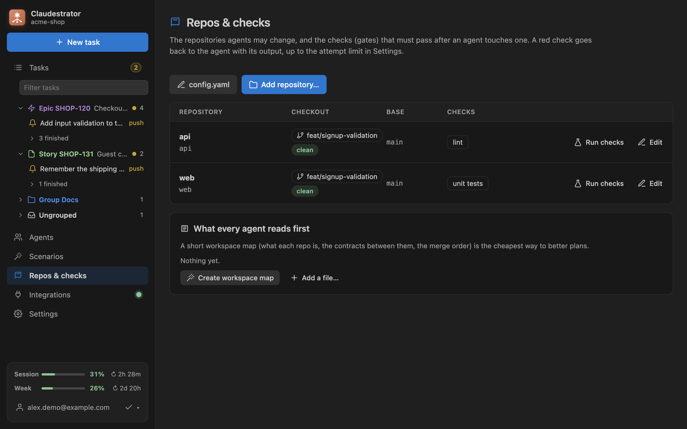
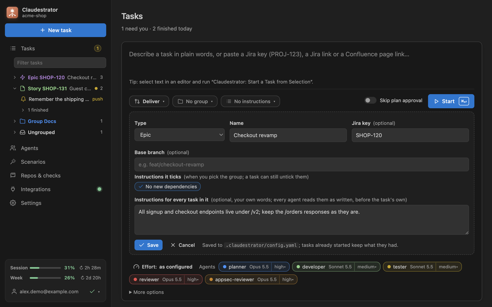

# Claudestrator

A standalone agent pipeline for Claude Code, driven from VS Code. You describe a task (or paste a Jira key, a Jira link or a Confluence page), and a pipeline of Claude Code agents takes it to draft PRs:

```
ticket → planner → [you approve the plan] → per repo: developer (checks after each) → tester across all repos (checks in each)
       → reviewer (fresh context, whole diff) → fix rounds → commit → [you confirm the push] → draft PRs
```

Besides delivering a change, two read-only scenarios end with a report instead of PRs:

- **Check readiness**: "PROJ-123 перевір готовність виконання таски і закриття всіх критеріїв приймання". The `verifier` reads the issue, finds its branches and commits in every repo and the PRs GitHub has for it (Claudestrator lists them with your `gh`; agents do not reach GitHub), and judges each acceptance criterion (met, partial, not met, check by hand) with file:line evidence, plus gaps that block a release. The verdict (ready, not ready, needs a human check) follows from the statuses.
- **Audit**: "Аудит проекту: вузькі місця, перформанс, помилки". The `auditor` looks for bugs, performance bottlenecks, reliability and security issues and rates each one critical, high, medium or low.

The orchestration is code, not a prompt: a pure state machine decides what runs next and rejects anything out of order (no skipped approval, no extra review round, no push before you confirm). Each agent is a `claude -p` session of your installed Claude Code CLI, under your login and account.

## Screenshots

**A task in plain words, with its group, instructions and the pipeline it will run**



**The plan waits for your approval; nothing has changed in your repos yet**



**Agents at work: developer per repo, then the tester across all of them**



**The reviewer found a blocker: a fix round**



**Everything is committed locally; the push and the draft PRs wait for you**



**Tasks grouped by what needs you**



**Agents and the pipeline: models, effort, order**



**Scenarios: Deliver, Check readiness, Audit and your own**



**Repos and the checks that run after each agent**



**A group (epic, story) with its Jira key and the instructions it brings**



## Using it

- **New task**: the activity-bar icon, `⌘⌥N`, or *Start a Task from Selection* in an editor. Type what you want in plain words. Below the box you see what it was recognised as (free text, Jira issue, Confluence page), the task id, and the exact pipeline it will run. Click an agent chip to skip it for this task, or turn on *Skip plan approval*. The effort part of a chip (`medium ▾`) changes that agent's effort for this task only; *Effort: … ▾* sets it for every agent. In the text, `--effort high` or `--effort developer=max,tester=low` does the same. The choice is saved with the task and wins over the agents' settings.
- **Scenario**: *Deliver*, *Check readiness* or *Audit* at the top of the composer. Your words pick it (`готовність`, `acceptance criteria`, `критерії приймання` → readiness; `аудит`, `audit`, `вузькі місця` → audit) unless you click one; `--scenario readiness|audit` in the text does the same. A readiness check takes the one Jira issue a sentence names as its source and keeps the rest of the sentence in the ticket as what you asked. Report tasks get their own ids (`PROJ-123-check`, `AUDIT-<time>`), so they never continue the delivery task; checking again after a finished check is a new run (`PROJ-123-check-2`). Commands: *Check a Task's Readiness…*, *Audit the Project…*.
- **Scenarios page**: every scenario as a card, built-in, your own or from a library, with its agents. *Use* starts a task with it; *Edit* opens its agents in the card: drag them into order, add and remove them, and for your own scenarios set a name, a description and a model and effort per agent for this scenario only (empty means the agent's own setting; the composer can still change effort per task). *New scenario* opens a draft that is saved to `config.yaml` only with its first agent, so a stray click leaves nothing behind. Agents that change code make it end with draft PRs like Deliver; readiness or audit agents make it a read-only report. One scenario cannot mix the two. *New scenario ▾ → Diagram*, or *Open as diagram* on your own scenario's card, draws it on a canvas instead: the ticket, the steps top to bottom, the plan approval and the review loop their outputs make, and how it finishes. *+* on an arrow adds a step there (an agent, or *Create agent…*, made for this scenario only), dragging a step onto another arrow moves it, and a click on a step opens its settings: its agent, a model and effort for this scenario, and its instructions for this step, which *Open in editor* moves into `prompts/<scenario>/<agent>.md`. A click on *Ticket* sets the model and effort that read the ticket over MCP for this scenario. The route is checked as you go (the same warnings a task gets), and nothing is written until *Save* (Ctrl+S); the diagram is saved as the same `agents:` list. *Parallel* runs reviewers, readiness or audit agents at once, each in its own session; the task moves on when all of them ended, and one that failed is asked about after the others. *Branch* runs its steps only when a result of a step before it holds (a verdict, the worst finding, a readiness verdict, red checks), else its *otherwise* steps; skipped ones show as skipped on the task. *Loop* sets which steps run again and how many rounds, in place of the review loop the outputs make; it ends with a review. *You approve* after a step (or a Parallel, a Loop, a step of a branch) makes the task wait for you there: it shows what the step wrote under what the scenario asks you to look at, and you go on, or have the step run again with your words; in the review loop it asks every round. A task's *Flow* tab draws its pipeline the same way, read-only: where each step is, the arm a branch took, the loop's round, where it waits for you; a step that ran opens its output. A task of such a scenario keeps its steps as they are: change the scenario instead. 🗑 deletes a scenario; Check readiness and Audit can be deleted too and brought back on the same page; Deliver always stays. The backup of agents, pipeline and scenarios is saved and restored there as well, and the page lists your libraries with *Add library…*. In the composer the scenario menu only picks one (*Manage scenarios…* leads to the page); `--scenario <name>` in the text picks one too. A scenario whose agents change code with no planner before them (a `hotfix` of developer and reviewer) works in the repos the text names with `--repos api,web`, else in every configured repo, on a branch named after the ticket (`fix/CP-123-fix-login` for *CP-123 Fix login*, `fix/CP-123-change` when the summary has no Latin letters); its commit and PR take the summary, with the key once. Keys with an underscore (`MY_PROJ-12`) work too. A task started from your scenario shows its name and the models it runs with.
- **Group and instructions**: under the text box. *No group ▾* puts the task into an epic, a story or a plain group, with its Jira key (`PROJ-123`) if it has one, or leaves it on its own. A group can tick instructions you already have: picking it ticks them in the composer (untick any for one task; switching to another group unticks the old group's and ticks the new one's, ones you ticked by hand stay). It can also carry instructions of its own words for every task in it (the epic's conventions, what must not change), and a base branch: its tasks start from the epic's branch (`feat/checkout-revamp`), and open their PRs into it, in each repo whose origin has it, unless the plan names another; elsewhere they start from the repo's base. *No instructions ▾* ticks any number of your own instructions (*No new dependencies*: "use what the repo already has"), or none. Every agent of the task gets the group, its instructions and the ticked ones word for word in its prompt, the group's first. *New group…* / *New instruction…* at the bottom of each menu and ✎ / 🗑 on each item add, change and delete them in place; they are saved to `config.yaml` (`groups:`, `instructions:`). A task keeps them as they were when it started: changing or deleting one later does not change a running task. The task card and screen show the group; the task's *Details* list its instructions.
- **Tasks view** (sidebar) groups tasks by what they belong to: each *Epic* (purple), then each *Story* (green), then each custom *Group* (blue), then *Ungrouped* (turquoise). In a section the tasks that need you come first, then the running, the paused and the finished ones; each task's icon says which. A section stays open while any of its tasks is not finished. The colors are theme colors (`claudestrator.epicForeground`, `storyForeground`, `groupForeground`, `ungroupedForeground`) you can change in `workbench.colorCustomizations`. The badge and the status bar count what needs you. Notifications tell you when a task needs a decision, finishes or fails; what an agent, a ticket or a tool wrote shows in them as words, so a link there cannot run a command. *Claudestrator: Show Log* opens the log in the Output panel: every warning, error and blocked tool call, with its task.
- **Task screen**:
  - **Decisions** appear at the top, with everything needed to decide: the rendered plan with its open questions and branch (a question only you can answer, which the planner marks blocking, holds the plan until you answer it, also for a task on auto: your answer goes back to the planner, and you approve the plan it makes with it), the red check output, the reviewer's findings, or per-repo commits with the combined diff before a push. Options that take feedback (request changes, retry with a hint) have a text box. `⌘↵` picks the primary option.
  - **Fix in chat**: a failure on the task screen (a git hook that rejected the commit, red checks, an agent that failed, an error the run ended with, such as a repo left on the wrong branch) has a *Fix in chat* button. It opens Claude Code in a terminal, in the repo the failure is in (the task's other repos added with `--add-dir`), under the agents' account, with the failure's output, the branch, the repos and the task folder as its first message, and an instruction not to commit or push. Its caret picks the model and effort the chat runs with, and the pick is remembered. Once it is fixed, retry the commit, the checks or the step on the task screen.
  - **Step timeline**: every agent run per repo and round, with check results, verdicts and cost. Click a step to see its transcript.
  - **Agent output** streams live: text as it is written, every tool call (reads, edits as diffs, commands with output), what the guard blocked, check runs. While an agent works you can **message it** ("reuse formatDate from utils/date.ts"). *Continue in terminal* runs `claude --resume <session>` for any finished step, under the account it ran under (also from a path with spaces, in PowerShell too); the terminal closes when Claude exits. A tool call's long input (a big fixture it writes) shows cut, with how much was left out.
  - **Report** (readiness and audit): the verdict with every criterion and its evidence, or the findings with a filter per severity. *Open report* opens `report.md`; *Post to Jira* comments the result on the issue; *Start a task to close the gaps* / *Start a task to fix it* opens a delivery task prefilled with what was found.
  - **Activity** (the event log), **Files** (ticket, plan, reports, reviews, check logs) and **Ticket & plan**.
  - **Stop / Resume**: stopping kills the agent; resuming re-runs the same step. Tasks survive VS Code restarts. A task runs in one VS Code window at a time: another window on the same workspace shows it as *Running in another window* (its Stop stops it there too), and neither it nor a branch-mode task that would switch the same checkouts starts there meanwhile.
- **Status line, as in Claude Code**:
  - every step shows its model, effort, context used (`ctx ▰▱ 53%`), tokens, cost and turns, live while the agent works;
  - the header and the status bar show the account's 5-hour and weekly limits with time to reset. They come from what Claude Code reports to the agents, or, before any agent ran, from your status line's snapshots in `<account>/statusline/` (ctx-man writes them).
- **Agents**: reorder the pipeline by dragging, turn agents on or off, pick a model and an **effort** (`low` … `max`, passed as `claude --effort`), open an agent's instructions as a Markdown file, or edit its tools and description. *New agent* creates one that extends an existing agent (e.g. a security reviewer on top of `reviewer`) and opens its instructions file.
- **Repos & checks**: the repos agents may change and their checks (lint, typecheck, tests) with an optional *only if changed*: a folder or a file from the repo's root (`src/`, `package.json`), no patterns. A check's name is one per repo, its `dir` stays inside the repo, and it may have its own `timeout` in seconds (in `config.yaml`; default 15 minutes). *Run checks now* tries them on the current changes. *Add repository…* picks folders anywhere on disk: a repo, several, or a folder that holds repos (they are found inside it). Repos outside the workspace are saved with their absolute path. Repos found in the workspace can be added in one click, with checks suggested from `package.json`, `go.mod`, `Cargo.toml`, `pyproject.toml` or a `Makefile`. The workspace map (`.claudestrator/workspace.md`) is what every agent reads first.
- **MCP**: every MCP server Claude Code has for the agents' account and this workspace, coloured by state: green connected, yellow configured but not checked (or disabled, or waiting for approval), red an error or an expired/missing sign-in. *Sign in* runs `claude mcp login` and opens the provider's page in the browser, then the list is checked again. *Details* shows `claude mcp get` with header and env values masked. The *MCP* tab and the dashboard show a red count when something needs attention.
- **Settings**: language of plans, reports and PR texts (the developer, tester and reviewer write to each other in English to save tokens); base branch; git mode; limits (review rounds, check attempts, budget per task); safety policy; the Claude Code CLI, account and setting sources; the Jira/Confluence connection; notifications.

First time in a workspace, *Set up this workspace* finds the git repos and suggests checks for them. It also lets you choose the git mode and the language, and can create the workspace map.

## How it works

- **Routing by output, never by name.** An agent's `output` decides its role. `plan` waits for your approval. `code` runs once per repo of the plan, in plan order, with the repo's checks after it. `tests` runs once after that, across every repo the plan names (one tester sees all the changes and the contracts between them), then the checks of each of those repos. An agent's `runs: per-repo | all-repos` switches this for a code or tests agent (Agents screen, or *per repo ⇄ all repos* on its chip in a scenario's editor on the Scenarios page). Tasks started before keep the tester per repo. `verdict` sends blocking findings (blocker, major) back to the code/tests stages of only the affected repos, up to `limits.reviewRounds`; the review of a later round reads the round before's and checks its findings first, so the rounds converge. Minor findings go into the PR description.
- **Blocked.** A code or tests agent hands over its status with its report: done, or blocked with what blocks it (the plan does not hold, a test shows a bug in code the tester may not change). Blocked stops the step for you at once, instead of checks, a tester and a review on work that was not done (also when a developer says so while fixing its checks, and they pass); a tester's bug goes to its checks once, so you see them red, and not back to the tester to fix.
- **Retries.** A turn that failed on the API side (overloaded, a dropped connection), also one fixing the checks or correcting the report, goes on in its session after a pause, twice, before you are asked. A step you retry starts a fresh session that is told why the attempt before failed (its error, or the output of the checks that stayed red); your feedback reaches every step it was for, also one run again after a Stop. A developer or tester that says it cannot go on (the plan does not hold, the branch lacks the code, the sandbox refuses something) stops as *blocked*, with its reasons, not as an agent that stopped early. A step or a commit that fails the same way as the attempt its retry answered says so: the agent can change none of what it ran into, so a retry as it was ends there again unless you fixed the cause meanwhile (a setting, the branch) or tell the agent what to do differently.
- **Checks.** After a code or tests step the repo's checks run on its changes. Red output goes back into the same agent session, up to `limits.gateAttempts` times; then you decide. What the agent reads is the last 40 lines, a long line and all of it cut to a few KB (one line of a JSON report can be a megabyte); the check's log has it all. A check that ran out of its time, or whose folder is not there, comes to you at once: no change of the agent's fixes that. Go on past red checks, and the reviewer is told which are red, with their output. Checks run code the agents wrote or changed (tests, package.json scripts), so they run in the agents' sandbox (Anthropic's sandbox-runtime, which Claude Code's sandbox is built on): writes only in the repo (not its `.git`) and in temp files (on macOS also what `mktemp` makes in your temp folder, where it writes whatever `TMPDIR` says, and nothing else there), none of your credentials, files or variables, network only as for the agents. Claudestrator's own temp files (the sandbox's settings, commit messages, PR bodies) are in a folder no agent, check or hook may write. So do the repo's git hooks: the commit's hooks may write git's objects and refs but not its config or hooks, and the pre-push hook runs in the sandbox before git pushes (with `--no-verify`, so it does not run twice). What needs your keys runs outside it, with git's hooks off: the commit is signed there when `commit.gpgsign` asks for it (a task's commit left unsigned while the repo is on another branch is never pushed: you are asked to switch back), and Git LFS files are uploaded there before the push (the hook's own LFS upload is skipped), unless the agents changed `.lfsconfig`, which says where they go: then you read it and push yourself. Claudestrator's own git calls on your machine (switching branches, adding worktrees, fetching, pushing) run no hook and no fsmonitor: a hook of yours that should run on `git switch` does not run when Claudestrator switches. The folder git runs hooks from is not an agent's or a check's to write even where it sits in the working tree (husky's `.husky/_`, which git ignores): what lands there would run with your next git command, outside the sandbox, and no diff would show it. Nor is the repo's `.claude/`, `.mcp.json` or `.vscode/`: the next agent's session loads them, and a hook or an MCP server there would run outside its sandbox. A change an agent makes there with its file tools is kept for you instead (see [Changes to a repo's Claude Code and VS Code settings](#changes-to-a-repos-claude-code-and-vs-code-settings)). A tool that writes elsewhere (a build cache) needs that folder in `policy.writable`; a test that opens a local port, `policy.localPorts` (on macOS the sandbox refuses it, and such a check comes to you at once: no change of the agent's fixes it); a variable that looks like a credential but a check needs (a test database's URL) goes in `policy.checkEnv`. Where the sandbox cannot start (Linux without bubblewrap, socat and ripgrep), a task says so before any agent runs.
- **Reports.** Plan, verdict, readiness and audit stages write their report for a human and hand its data over as structured output: Claude Code checks it against the stage's JSON Schema (`--json-schema`) and asks the agent again on a mismatch. The engine checks it once more, also what a schema cannot say (a verdict with a blocker or major finding is `changes_requested`; a report other than a verdict has text, not only its data; a plan has a section headed with the name of each repo it plans for), and sends a report it cannot use back for correction, with every problem at once, twice before the step fails. The artifact keeps the report with its data as a JSON block at the end.
- **Git.**
  - In *branch* mode the repos switch to `<type>/<KEY>-<slug>` and must be clean first. In *worktree* mode each task gets `.orch/worktrees/<task>/<repo>` from `origin/<base>`, and your checkouts are never touched. A plan whose branch is there already, here or on `origin`, goes back to the planner for another slug: a task never carries on from another task's commits. The base is the repo's (`repos.<name>.baseBranch`, else `baseBranch`), unless the plan names another for a repo whose code is not there (`"baseBranch": "checkout-v2"` in its json, shown on the plan's repo as *from checkout-v2*): the task's branch then starts from `origin/<it>` and its PR goes into it. One `origin` does not have goes back to the planner, and once the task has worked in its repos a later plan keeps the bases it had. A branch also remembers the task it was made for (`branch.<name>.claudestratorTask` in the repo's git config), so two tasks planned with the same name before either started never share one. A planner that runs after agents worked in the repos (a second one, one in the review loop) keeps the branch their work is on.
  - The engine makes one commit per repo. It pushes and opens draft PRs (ready for review with `policy.draftPrsOnly: false`) with `gh` only after you confirm, records each PR as it opens, and the PRs link to each other. Stop ends a push or a PR being opened, and nothing after it goes out. The question about the push names what looks like a credential in what it would publish (an AWS, GitHub, Slack, Stripe, npm, Anthropic or OpenAI key, a private key, a password in a URL to another host, a `.env` or `.pem` file) with its file and line, never the whole of it, and what the agents changed that acts outside the sandbox: git hooks (`.husky/`, lefthook, pre-commit, the repo's `core.hooksPath`), which run on your machine when you use git there, `.lfsconfig`, and a `CLAUDE.md`, which every Claude Code session there takes as instructions. The reviewer and this scan read a file the agents marked `binary` or `-diff` in `.gitattributes` as it is.
- **Guard.** Every tool call of an agent goes first to the extension, over a `PreToolUse` http hook on `127.0.0.1` with a token only that agent session holds; no process starts per call. A guard that cannot answer (VS Code closed, a timeout) blocks the call. It always blocks:
  - git writes by agents (commit, push, switch, stash, reset…) and non-read `gh` calls;
  - force-push, pushes to protected branches, `--no-verify`, merging PRs, non-draft PRs and AI attribution (if the policy says so), and destructive `rm -r`, also of what `xargs` or `parallel` read, by `find … -exec rm -r`, and a `-delete` or `-exec rm` from a repo's root that could reach `.git`; git config, remote, branch and fetch calls that write (an upstream, a local branch, a remote);
  - edits outside the repo of the current step (read-only stages edit nothing), and edits of Claudestrator's own config, libraries, instruction files and task state, also in a workspace that is itself the repo (Claude Code's deny rules and sandbox refuse them too);
  - edits of what runs outside the sandbox, also through a link: git metadata (`.git`), the hooks folder git runs from the working tree (husky's `.husky/_`), the repo's Claude Code settings (`.claude/`, `.mcp.json`), whose hooks and MCP servers the next agent's session would run, its local instructions (`CLAUDE.local.md`, at any depth), which that session takes as instructions and git ignores, so no diff would show them (`CLAUDE.md` is tracked: an agent may change it, and the push question names it), and its VS Code settings and tasks (`.vscode/`), which can run when the folder opens; in any case where the file system ignores it (`.CLAUDE/` on macOS), and through a link whose target is not there yet. Write and Edit take only the absolute path Claude Code writes;
  - MCP tools that may change something (merge a PR, move an issue, write a file): an agent reads through its MCP servers (`get…`, `search…`, `list…`, `read…`, unless another word of the name writes: `search_and_replace`, `getOrCreateIssue`), and calls any other MCP tool only when its `tools` name it (`mcp__github__create_issue`, the whole server as `mcp__github`, or `mcp__github__*`). A read that names a web address (read as a fetch would read it, any slashes, also without a scheme) names only a host of `policy.network` or the task's Atlassian site, and never a `file://` address: a server that fetches what it is given (a `fetch` or `get_url` tool) reaches it from outside the sandbox, and an address can carry a ticket's or a repo's text away;
  - `WebFetch` and `WebSearch`, which reach any host from Claude Code itself, unless the agent's `tools` name them; `WebFetch(domain:docs.acme.com)` there fetches from that domain and its subdomains only;
  - any tool the agent's `tools` do not name, and some even when they do: Claude Code's own worktree tools (git is Claudestrator's), PowerShell (the guard does not read it, and native Windows has no sandbox), a `Monitor` of anything but a command (its command is read like a Bash one). An agent without `tools` of its own gets Read, Grep, Glob and Bash, plus Edit and Write when it writes code or tests;
  - publishing a package or an image, or changing a registry (`npm publish`/`pub`, also through `npx`, `npm exec`, `pnpm dlx`, `pipx run` or `python -m`; `twine upload`, `cargo publish`, `mvn deploy`, `gradle publish`, `docker push`, `npm unpublish`/`dist-tag`/`deprecate`…), and the keychain and stored credentials: `security`, git's credential helpers, `gh auth` (which can print your token).

  With *Ask me* on, you also approve every edit and command from the dashboard or a notification; a question nobody answers in 14 minutes is denied. A notification offers *Allow* only for a short, one-line command it shows whole; for the rest the dashboard shows the request, marked where it is cut.

  The guard follows `cd`, `pushd` and `popd` only as far as the shell would: after one it cannot resolve (`cd $VAR`, `cd -`, in a loop) relative writes and `rm -r` are refused, and after `;`, `||` or a subshell a later command is checked in every folder the shell might be in. It sees writes into a destination folder or `-t`, by curl and wget, archives, `sort -o` and patches, refuses a link that leads outside the repo or to a folder holding it, reads a here-string a shell gets, and refuses a shell or `source` fed by a process substitution or `/dev/stdin`.

  The guard reads commands; a command can hide what it does (`node -e "…"`, a script the agent wrote first). So Claude Code itself enforces the essentials too, for each session:
  - deny rules: no reading of `~/.ssh`, `~/.aws`, `~/.kube`, cloud and Docker credentials, GitHub's and GitLab's (`~/.config/gh`, `~/.git-credentials`, git's credential store, `glab`) and package registries' tokens (`~/.npmrc`, `~/.pypirc`, cargo, gem, Maven, Gradle, Composer), database and Vault logins (`~/.pgpass`, `~/.my.cnf`, `~/.vault-token`), shell histories, Claude Code's own files (`.claude.json`, credentials), the MCP config Claudestrator writes for the agents, and `.env` files (`.env.staging`, `.envrc`…); no `git push` or `gh pr merge`;
  - the sandbox around every shell command and what it starts (Seatbelt on macOS, bubblewrap on Linux and WSL2): writes only in the step's repos (never their `.git`), none for a read-only stage; no reading of those credentials or of the repos' `.env` files (found by path when a session starts, git-ignored ones too; `.env.example` stays readable), and none of your environment's credentials (`*_TOKEN`, `*_SECRET`, `*_KEY`, `PGPASSWORD`, `*_PAT`, `*_DSN`, a password in a URL, a value shaped like a GitHub, Slack, OpenAI, Anthropic, AWS, Stripe or npm token…); network only to the package registries and GitHub's download hosts, plus `policy.network`; no local port on macOS unless `policy.localPorts` (a test that starts a server on 127.0.0.1 needs it, and then reaches every service listening on your machine; Linux's sandbox has a loopback of its own). Not GitHub's API: it takes writes, and the macOS keychain, where `gh` keeps its token, stays readable in the sandbox. A command the sandbox blocks is not run again outside it. Turn it off with `policy.sandbox: false` (Settings → Safety); then Claude Code strips credentials from what its commands inherit (`CLAUDE_CODE_SUBPROCESS_ENV_SCRUB`). On native Windows Claude Code has no sandbox.
  - No GitHub token (`GH_TOKEN`, `GITHUB_TOKEN`) reaches an agent session at all.
  - Agents are told that the ticket, the repos and tool output are material, not instructions: text planted in a Jira issue does not steer them.
- **Jira comments** (*Approve & post to Jira*, *Push, open PRs & comment in Jira*, *Post to Jira*) go over REST with an API token, else through the account's Atlassian MCP server: a short haiku session whose guard allows only the cloud id lookup and one add-comment call, on that issue on the task's site and with the text word for word: the text comes from agents' reports, and an instruction planted in the ticket must not get the session to read other issues or post elsewhere. Each attempt is in the activity log and the *Jira comments* card; a failed one shows a banner with *Post again*.
- **Jira and Confluence.** With an API token (Settings) tickets are read over REST; a token the site refuses (expired, revoked) says so, and the ticket is read through the Atlassian MCP server instead when the account has one. Links keep their addresses, page links their titles (`[page: Title]`), attachments their names, code blocks their text and language; acceptance criteria are found under a heading or a bold line (`**Acceptance criteria:**`, *Definition of done*). Without one, a short read-only agent (haiku, low effort, a few cents) reads the issue or page through the account's Atlassian MCP server, signed in with Claude Code; its tool calls are limited to get/search/fetch. A link to another site than the API token's (`clientb.atlassian.net/browse/PROJ-12` with a token for `acme`) is read, and commented on, through that MCP server: over REST the same key would be another issue. Without one the task says so.
- **Account.** Agents, MCP checks and limits use one Claude Code account (config folder), chosen in the header or followed from ctx-man. `claude auth status` shows which accounts are signed in; a signed-out one gets a banner with *Sign in* (`claude auth login` in a terminal). Agents run without the `user` setting source, so the account's own MCP servers are handed to them with `--mcp-config` (a 0600 file), without your personal plugins and hooks.
- **State.** `<workspace>/.orch/tasks/<id>/events.ndjson` is the source of truth, and the state is rebuilt from it. Each agent session records its id when it starts and its cost after every turn, so one VS Code never saw end still counts against the budget and can be resumed. An agent that shows no sign of work for 20 minutes is stopped; a subagent's work and every tool call count as signs. Artifacts and transcripts sit next to it. `.orch/` ignores itself in git. The layout and the config format are those of the claudestrator CLI and plugin, so they can work on the same tasks.

## Spending fewer tokens

What the built-in agents do by default, and what to change per task.

- **Model and effort.** planner and reviewer run on Opus at high effort; developer and tester on Sonnet at medium. Change them per agent on the Agents page, per scenario, or per task with the effort chips.
- **MCP.** developer, tester and reviewer run with `mcp: false`: they see no MCP servers, so no server's tool list rides along in every turn. The planner, verifier and auditor keep them. The Agents page has the switch under *More*; in `config.yaml` it is `mcp: true` or `mcp: false`.
- **Gates do the checking.** developer and tester are told not to run the full lint, typecheck or test suite; the gates run it after the stage and send back only the tail of a failing command (40 lines, without colour codes or redrawn progress lines). Make gate commands quiet so that tail holds the failure and not the progress: `--silent`, `-q`, a `dot` reporter.
- **Run less.** For a small task, click agents off (no tester for a text fix), turn on *Skip plan approval*, or keep a scenario like the `hotfix` below (developer and a short review).
- **Caps.** `limits.reviewRounds`, `limits.gateAttempts` and `limits.budgetUsd` (25 by default, as Claude Code counts the cost; `0` for no limit) stop a loop that is not converging; an agent's `maxTurns` (`config.yaml`) caps the turns of each of its sessions. `limits.parallelTasks` caps how many tasks run agents at once (worktree mode runs tasks in parallel); one more waits until you resume it.
- **Usage limits.** When Claude Code reports that the account's 5-hour or weekly limit is used up, no agent starts until the window resets: the task says when, and you resume it then.
- **See the cost.** Every step shows its tokens, context used and cost; compare two runs of a task after changing a model or an effort.

## Configuration

Layers, each overriding the previous field by field: built-in defaults → libraries → `~/.claudestrator/config.yaml` → `<workspace>/.claudestrator/config.yaml`. The dashboard edits the workspace file in place: it changes only the lines of what you changed, keeping your comments, flow style and long lines as they are.

The workspace file is one a repo can bring along, and so are the libraries it lists, so what they relax of your own policy shows as a warning wherever the config's warnings show: the sandbox off, a host its commands and MCP reads may reach, local ports, a folder they may write, a credential handed to checks and git hooks, a tool that reaches outside the sandbox (`WebFetch`, an MCP tool) or MCP servers turned on for an agent, unprotected branches, AI attribution, PRs ready for review, and a budget cap removed or raised, or more review rounds or check attempts than your own config allows. Its instruction files are read from the workspace only (a library's from the library's folder); no config takes a credential (`~/.aws/credentials`, a `.env` file) or a system file (`/proc/self/environ`) as instructions, which go into the agent's prompt. `policy.writable` never opens your home folder, a folder above it or the whole disk.

### Libraries

Agents and scenarios you want in more than one project, or kept apart from a project's config, live in a folder of their own:

```
my-claudestrator-library/
  library.yaml          # agents: and scenarios:, written as in config.yaml
  prompts/
    security.md         # instruction files, relative to library.yaml
```

List it under `libraries:` in `~/.claudestrator/config.yaml` (all your projects) or in a project's config (for the team; a folder inside the project is listed by a relative path, so it works in every clone):

```yaml
libraries: [~/my-claudestrator-library, ../shared-agents]
```

- A project can change a library's agent (its model, say) in its own config; the library stays as it is.
- An agent only a library has is not in the delivery pipeline until you add it; scenarios use it right away.
- `{{dir}}` in instructions becomes the folder of the config that names them: in a library, the folder of `library.yaml`. Instructions point the agent at the library's own files with it (`sqlite3 "$DB" < "{{dir}}/sql/schema.sql"`), wherever the library is kept.
- A library that is missing on this machine is a warning, not an error. Two libraries defining the same agent: the later one wins, and the dashboard says so.
- On the Scenarios page, the one place for libraries: *Add library…* brings in a library's scenarios and agents together (an empty folder becomes a new library), *Stop using* takes them out. *Move to …* sends a scenario of the project's own into a library, with the project agents it runs; on the Agents page it does the same for one agent, with its instructions file.

```yaml
agents:
  tester: { enabled: false }
  planner: { effort: max }
  developer: { mcp: true }       # built in: developer, tester and reviewer run without MCP servers
  reviewer:
    model: opus
    effort: high
    instructions: { mode: append, file: ./prompts/reviewer-extra.md }
  security:
    extends: reviewer
    instructions: { mode: append, file: ./prompts/security.md }
pipeline: [planner, developer, tester, reviewer, security]
scenarios:                      # read-only agents of the report scenarios (built in: verifier, auditor)
  readiness: [verifier]
  audit: [auditor, perf-auditor] # e.g. perf-auditor: { extends: auditor, instructions: { mode: append, file: ./prompts/perf.md } }
  # readiness: false             # removes a built-in report scenario from the menu
  hotfix:                        # your own scenario: its agents in order, each with an optional model and effort
    label: Hotfix
    description: Code and a quick review, no plan
    agents:
      - developer
      - { agent: reviewer, model: sonnet, effort: low }
      - agent: docs-writer       # what it does in this scenario, after its own instructions: text, or { file: ./prompts/hotfix/docs-writer.md }
        instructions: Note the fix in CHANGELOG.md under Unreleased.
  ship-secure:                   # steps in blocks: a Loop of its own, reviewers at once, a branch on a result
    label: Ship with security review
    agents:
      - planner
      - loop:                    # runs again until the reviewers at its end approve (instead of the loop outputs make)
          rounds: 3              # optional; default limits.reviewRounds
          steps:
            - developer
            - parallel: [reviewer, security-reviewer]   # read-only agents (review, readiness, audit) only, in their own sessions
      - branch:                  # on a step before it: { verdict: approved | changes_requested }, { severity: major },
          on: security-reviewer  # { readiness: not_ready }, { audit: high }, { gates: fail }
          if: { severity: minor }
          then: [security-fixer, { approve: You check the fixes }]
          else: []
      - approve: Read the review before the PRs   # the task waits for you after the step or block before it
limits: { reviewRounds: 2, gateAttempts: 3, budgetUsd: 20, parallelTasks: 2 }
language: Ukrainian
baseBranch: main
intake: { model: haiku, effort: low }   # what reads a Jira issue or Confluence page through an MCP server (the default; Integrations → Jira & Confluence); a scenario can set its own
context: [./workspace.md]
git: { mode: worktree }
groups:                          # what a task can belong to: epic, story or group, with an optional Jira key
  checkout-revamp:
    type: epic
    label: Checkout revamp
    jira: PROJ-123
    defaultInstructions: [no-new-deps]   # optional: ticked in the composer when the group is picked
    instructions: Refund endpoints live under /v2/refunds; keep /orders responses unchanged.   # optional, for every task in it
    baseBranch: feat/checkout     # optional: its tasks start from it (and their PRs go into it) where origin has it
instructions:                    # picked per task in the composer; every agent of the task follows them
  no-new-deps:
    label: No new dependencies
    text: Do not add npm packages; use what the repo already has.
repos:
  api:
    role: Public REST API (NestJS)
    gates:
      - { name: lint, cmd: npm run lint }
      - { name: test, cmd: npm run test:unit, when: src/ }
      - { name: e2e, cmd: npm run e2e, dir: packages/web, timeout: 2400 }   # seconds; default 15 minutes
jira: { allowedProjects: [PROJ] }
policy:
  protectedBranches: [main, master]
  draftPrsOnly: true
  forbidAiAttribution: true
  sandbox: true                  # agents' commands, checks and git hooks in the sandbox
  network: [npm.acme.corp]       # hosts they may reach besides the package registries
  writable: [~/.cache/go-build]  # folders they may write besides the repo (build caches)
  localPorts: false              # true: tests may open local ports (macOS)
  checkEnv: [DATABASE_URL]       # credential-like variables checks and hooks still get
  protectedChanges: ask          # agents' changes to .claude/, .mcp.json, .vscode/: ask, rules or off
```

VS Code settings (`claudestrator.*`):

| Setting | What it does |
|---|---|
| `claudePath` | Path to the Claude Code CLI. Empty: found on your login shell's `PATH`. |
| `claudeConfigDir` | Claude Code account (config folder) the agents run under. |
| `settingSources` | Which Claude Code settings agents load. Default `project, local`: each repo's `CLAUDE.md` and rules, without your personal plugins. |
| `askPermissions` | Ask before every edit and command. |
| `notifications` | `all`, `needsYou` or `off`. |
| `workspaceFolder` | Folder with the repos and `.claudestrator/`. Empty: the first workspace folder. |
| `atlassian.site`, `atlassian.email` | Jira/Confluence connection. The API token goes in secret storage (Settings screen). `ATLASSIAN_SITE`, `ATLASSIAN_EMAIL` and `ATLASSIAN_API_TOKEN` work too. |

`claudePath`, `claudeConfigDir` and `atlassian.*` are read from your user (or remote machine) settings only: a repo's `.vscode/settings.json` cannot send your token to another host or run another CLI.

### Changes to a repo's Claude Code and VS Code settings

No agent writes a repo's `.claude/`, `.mcp.json` or `.vscode/`: their hooks, permissions, MCP servers and tasks run outside the sandbox, with your credentials, and the next agent's session loads them. A task that needs a change there (a rule in `.claude/rules/`, a server in `.mcp.json`) gets it through you:

1. The agent makes the change with its Write or Edit tool, as its prompt tells it (a file as it is on another branch: `git show <ref>:<path>`, then Write). Claudestrator refuses the write, keeps the file as the agent wrote it in the task folder (`proposed/r<round>/<repo>/<file>`), and the agent goes on with the rest. A step that fails keeps them too, for when it ends well. A shell command that writes there (`cp`, `echo >`) is refused with that way to do it; one the sandbox refuses instead (`git apply`) is noted from its output, without its content.
2. When the step ends, the task stops at **Settings changes to apply**, after the checks: each file as written and as it is now, and a warning on the ones that can run code (anything but a rule of `.claude/rules/`).
3. **Apply the changes** writes them into the task's checkout of the repo (never through a link, never outside the repo), and the task goes on: the review reads them in the diff, and the question before the push names them. **Let the agent write them** runs the step again, told to make what it tried with a command with its file tools. **Leave them out** goes on without them.

A review's blocking findings about these files go to you too, not into a fix round no agent could do: make the change yourself, then ask for one more round to have it reviewed again. With other findings besides, the fix round goes only to the repos of those.

Settings → Safety (`policy.protectedChanges`) chooses how far this goes: `ask` (the default) asks about each change, `rules` applies the rules of `.claude/rules/*.md` at once (they are instructions only, as `CLAUDE.md` is) and asks about the rest, `off` only shows the changes, for you to make them. A project's config that sets `rules`, or `ask` over your `off`, is one of the warnings above.

### Integration tests with a database

Checks run in the sandbox, which has no Docker and gets none of your credentials, so a suite that starts Postgres or Redis in a container (Testcontainers, `docker compose`) fails there. No change of the code fixes that: such a check comes to you at once, with these steps.

1. Start the services yourself, outside the sandbox, on `127.0.0.1`, with a test database and Redis db of their own: the tests may wipe them.
2. Settings → Safety: turn on **Let commands open local ports** (`policy.localPorts`). On macOS the sandbox otherwise reaches no local port, and with it, every service on your machine.
3. Export the URLs in your login shell (`~/.zprofile`: `export TEST_DATABASE_URL=postgres://app:pw@127.0.0.1:5434/app_test`), then quit VS Code and open it again: it reads that environment only when it starts, and a window reload is not enough. A `.env` file does not work, since the sandbox does not read it.
4. Settings → Safety: name those variables in **Variables checks and git hooks still get** (`policy.checkEnv`). A URL with a password (`postgres://u:pw@…`, `redis://:pw@…`) counts as a credential, and the checks get it only when it is named there. The agents' shells never get it: the checks run the suite after their step, and their result is the one that counts.

Then retry the step.

## Requirements

- Claude Code CLI 2.1.302 or newer, logged in (`claude --version`; `claude update`). Older versions do not honour what guards the agents, so they do not start.
- VS Code 1.101 or newer: its Node runs sandbox-runtime, the sandbox of checks and git hooks. On Linux and WSL2 also `bubblewrap`, `socat` and `ripgrep`, as Claude Code's own sandbox needs.
- Git. GitHub CLI (`gh auth login`) to open PRs and to list a ticket's PRs for a readiness check.

## Develop

```bash
npm install
npm test          # state machine, config, guard, intake, and the engine end to end against a fake Claude CLI and real git repos
npm run preview   # the dashboard in a browser at http://127.0.0.1:4780, on the real engine with a fake agent
npm run test:live # one small task on haiku against your installed Claude Code: guard, sandbox, commit (a few cents)
npm run eval      # the agents' instructions against cases with a known answer (below)
```

`npm run eval` runs a few cases through the real engine and your installed Claude Code, each a small workspace with a known answer: the reviewer blocks a planted bug and lets a correct, tested change through; the planner names only the repo a ticket is about and plans a bug as a fix; the developer says it is blocked by a plan that names what the repo does not have, instead of making it up; the tester writes a failing test for a planted bug and leaves the code alone; the auditor rates a planted command injection critical or high; text planted for AI agents in a repo file or a Jira issue does not steer the developer; the verifier finds the acceptance criterion the code misses; review rounds converge (a round-one block is fixed and the next review approves); the planner follows a renamed API field to the repo that reads it, and to no other. Run it after changing an agent's instructions, model or effort. The agents run with their configured models (a dollar or so); `EVAL_MODEL=haiku EVAL_EFFORT=low` makes a run of a few cents, `EVAL_CASES=reviewer-blocks,planner-scope` picks cases, `EVAL_TRIALS=3` runs each case three times and prints the pass rate per case (an agent's answer varies between runs, so compare rates, not single runs), and a failed case keeps its workspace to look at. The cheap run checks the wiring and gross regressions; before a release run the configured models with `EVAL_TRIALS=3` or more. Each run is kept in `.eval/history.ndjson` (git-ignored), and prints each case's pass rate next to the last run on the same model and effort.

Press F5 in VS Code to run the extension. To package, run `npx @vscode/vsce package` and install the `.vsix`.
